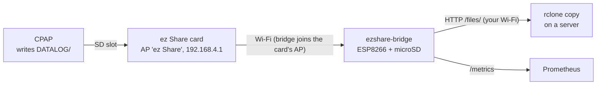
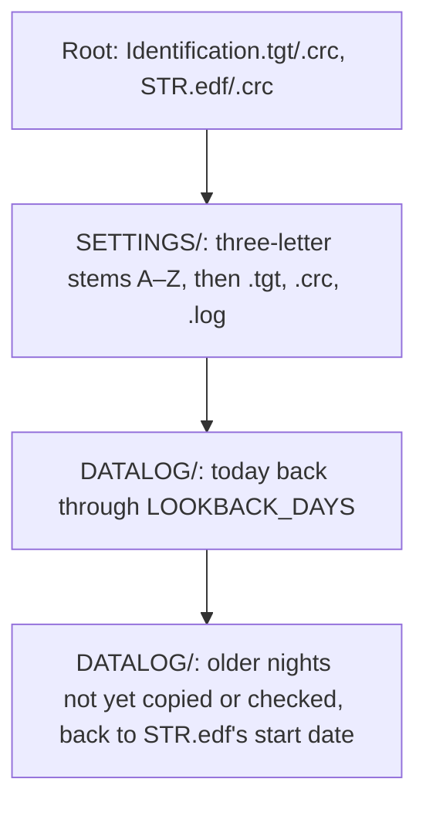

# ezshare-bridge

Firmware that copies a CPAP's data off an [ez Share](https://www.ezsharewifi.com/) Wi-Fi SD
card and makes it available on your home network.

The ez Share card only runs its own access point: it can't join your Wi-Fi. Something has to
join the card's network, download the files, and bring them back. This firmware does that on
a FYSETC SD-WIFI (the non-Pro, ESP8266 model) with a microSD card in its slot:



Every hour inside a daytime window, the bridge:

1. leaves your network and joins the card's;
2. finds the files in the card's root, `SETTINGS/` and `DATALOG/` folders, and downloads every
   file that's new or changed to its own microSD;
3. rejoins your network.

Between runs it serves the copied files at `http://<bridge>/files/` for a puller such as
rclone, and health metrics at `/metrics`. The bridge never deletes anything, so your puller
can't lose data because of it.

## Hardware

- **FYSETC SD-WIFI (non-Pro)**: ESP-M2 module (ESP8285, 1 MB flash), microSD socket on SPI
  (CS GPIO4, SCK 14, MISO 12, MOSI 13), CH340E USB serial. Leave its SD-card edge unplugged;
  power it from USB.
- **A microSD card**, FAT32. The bridge keeps a full copy of what it downloads. A night of
  ResMed data is a few MB, so any size works.
- **An ez Share Wi-Fi SD card** in the CPAP. The bridge is tested against card firmware
  LZ1001EDPG 4.4.0.

The card may need a `DCIM/100CANON/` folder holding one `.JPG` before its web server answers
downloads. This isn't confirmed yet; if every run ends in `probe_failed`, add them from a
computer.

The ESP8266 has one radio, so it can be on only one network at a time. While a sync runs
(seconds to a few minutes), the bridge is unreachable from your network.

## Set up

You need [mise](https://mise.jdx.dev/), which installs `uv` and runs PlatformIO through it.

### 1. Credentials

Either copy the example and fill it in:

```bash
cp include/secrets.h.example include/secrets.h
```

or write it from 1Password with `mise run secrets`. That needs two items:

- one with fields labelled `wifi_network` and `wifi_password` for your network;
- one with fields labelled `ezshare_ssid`, `ezshare_password` (the card's defaults are
  `ez Share` and `88888888`), `ota_password` and, optionally, `hostname` and `syslog_host`.

Put their IDs in `mise.local.toml`, which is gitignored:

```toml
[env]
OP_ACCOUNT = "your-account"
EZB_OP_VAULT = "vault-id"
EZB_WIFI_ITEM = "item-id"
EZB_BRIDGE_ITEM = "item-id"
```

### 2. First install

Set the board's switch to `USB2UART`, plug it in, and run:

```bash
mise run flash
mise run monitor   # prints the IP address it gets
```

The bridge sends its hostname (`ezshare-bridge` unless you set `BRIDGE_HOSTNAME`) with every
DHCP request, so you can find it in your router's client list and reserve its address. It
also answers to `<hostname>.local` over mDNS.

### 3. Later installs

```bash
mise run ota <ip-or-hostname.local>
```

## Pulling the files

`/files/` also answers WebDAV `PROPFIND`, read-only, so rclone's `webdav` backend gets every
file's size and date from one request per folder:

```bash
rclone copy :webdav: /path/to/cpap-data \
  --webdav-url http://<bridge>/files/ \
  --transfers 1 --checkers 1 --check-first
```

The bridge serves one request at a time, hence `--transfers 1 --checkers 1`. `--check-first`
makes rclone list everything before it copies anything, so its progress shows the real total.
The bridge answers a `Range: bytes=<first>-` or `bytes=<first>-<last>` request with `206`, so
rclone resumes a cut-off download instead of starting over.

In a browser, `/files/` is a plain HTML index. rclone's `http` backend can read it too, but it
sends a `HEAD` request per file to learn sizes and dates, which gets slow as the nights pile up.

Each file has an exact size and a `Last-Modified` time of when the bridge downloaded it, so
rclone only copies what changed. Don't add `--delete`: if the bridge's microSD is ever replaced, a
mirror with `--delete` would remove your history.

The layout matches the SD card's: `STR.edf`, `Identification.*`, `SETTINGS/`, `DATALOG/<date>/`.

## The LED

The board's ESP-side LED (LD2, on GPIO2) shows what the bridge is doing:

| Pattern | Meaning |
|---|---|
| A short blink every second | Syncing. The bridge is on the card's network and won't answer on yours. |
| A double blink every 2 seconds | The last run failed. It stops after 5 minutes; check the logs or `/metrics` for why. |
| Off | Idle, and the last run succeeded or ran out of time and will carry on next run. |

## Restarting

`mise run restart <host>` restarts the bridge, which starts a sync right away. It sends
`POST /restart` with Digest auth, the user `bridge` and the OTA password from `include/secrets.h`. A
restart doesn't power-cycle the ez Share card; only the CPAP can do that.

## Metrics

`GET /metrics` returns Prometheus text format:

| Metric | Meaning |
|---|---|
| `ezshare_bridge_sync_last_success_timestamp_seconds` | Unix time of the last run that finished with nothing left to copy |
| `ezshare_bridge_sync_runs_total{result}` | Runs by outcome (below) |
| `ezshare_bridge_sync_duration_seconds` | How long the last run took |
| `ezshare_bridge_files_downloaded_total`, `ezshare_bridge_bytes_downloaded_total` | Copied from the card |
| `ezshare_bridge_probes_total` | Requests that asked the card whether a file exists |
| `ezshare_bridge_pending_files` | Work the last run left for the next one: files, or a folder it didn't reach |
| `ezshare_bridge_sd_ok`, `ezshare_bridge_sd_free_bytes` | The bridge's microSD. Free space takes a full scan of the card's FAT, so it's measured after each sync and missing until the first one. |
| `ezshare_bridge_wifi_rssi_dbm{network}` | Signal on your network (`home`) and the card's (`ezshare`, as of the last run) |
| `ezshare_bridge_uptime_seconds`, `ezshare_bridge_free_heap_bytes`, `ezshare_bridge_build_info{version}` | Device health |

A run reports the first failure it hit:

| Outcome | Meaning |
|---|---|
| `ok` | Everything on the card is copied |
| `join_failed` | The bridge couldn't join the card's network |
| `probe_failed` | A probe got neither a match (206, or 200 for a whole small file) nor 404, or timed out |
| `download_failed` | A download failed, or came up short after three resumes |
| `sd_error` | The bridge's own microSD failed |
| `time_budget` | The run hit `SYNC_TIME_BUDGET_SECONDS` with work left |

Counters reset when the bridge reboots. A useful alert: the last success is more than a day
old. That covers a bridge that's down, a card it can't reach, and a backlog that never clears.

## Logs

The bridge writes one JSON line per event to the serial console and to `/.bridge/log.txt` on
its microSD: boot, each sync run's outcome, each copied file, and every failure with its
details. Lines logged during a run carry `run`, a number that goes up by one each run and
survives restarts (`/.bridge/runs`), so one run's lines can be read together.

```json
{"ts":"2026-11-20T14:00:41Z","up":3612,"level":"warn","logger":"ezshare-bridge","event":"download_stalled","run":12,"path":"/DATALOG/20261119/20261119_221502_BRP.edf","bytes":512000,"total":4190420}
```

| Event | Fields |
|---|---|
| `boot` | `version`, `reset_reason`, `ip`, `sd_ok`, `lookback_days` |
| `copied` | `path`, `bytes`, `ms` (from the first request to the rename) |
| `sync` | `result`, `files`, `bytes`, `pending`, `probes`, `folders` (night folders found on the card), `seconds`, `ezshare_rssi` (the card's signal when the run joined it), `home_rssi` (the home network's, after rejoining), `lookback_days` |
| `join_failed` | `ssid`, `wifi_status` |
| `probe_failed` | `pattern`, `folder`, `status` (the HTTP status, or a negative client error) |
| `download_stalled` | `path`, `bytes` (in `<name>.part` so far), `total`, `cause` (`sd_short_write`, `timeout` or `closed`), and on a short write `chunk` and `written`; the bridge resumes from there |
| `download_restarted` | `path`, `status`: a resume got something other than 206, so the file starts over |
| `download_failed` | `path`, `status` |
| `sd_error` | `op`, `path`, and for a failed rename `sd_error_code`, SdFat's code for the card's last error |
| `night_restaged` | `path`: a finished night had a failed copy, so it's staged again and the next run searches it whole |

`ts` is empty until NTP answers; `up` (seconds since boot) orders lines regardless. `level` is
one of `debug`, `info`, `warn`, `error`, `fatal`.

`GET /log` returns the current log file.

### Shipping to syslog

Set `SYSLOG_HOST` and the bridge sends each line as RFC 5424 syslog over UDP, whenever it's on
your network: right after each sync, and every 10 seconds otherwise. The file is the buffer.
Lines logged while the bridge is on the card's network wait there and go out when it's back.

```
<134>1 2026-11-20T14:00:41Z ezshare-bridge ezshare-bridge - - - {"ts":"2026-11-20T14:00:41Z",...}
```

The priority is facility local0 plus the line's `level`. The timestamp is the line's `ts`, or
`-` before NTP answers. The hostname is `BRIDGE_HOSTNAME`, the app name `ezshare-bridge`, and the
message the JSON line itself. A line can reach the receiver minutes after it was logged, so use
the syslog timestamp rather than the time it arrived.

UDP has no acknowledgement: a datagram lost on the network is gone from the receiver, but stays
in the file. The file rotates to `log.1.txt` at 256 KB once every line has been sent, or at 1 MB
regardless if nothing is sending (`SYSLOG_HOST` empty).

## Configuration

Everything besides credentials has a default in `include/config.h`. Override any of them in
`include/secrets.h`:

| Setting | Default | |
|---|---|---|
| `BRIDGE_HOSTNAME` | `ezshare-bridge` | DHCP and mDNS name, and the syslog hostname |
| `SYSLOG_HOST`, `SYSLOG_PORT` | empty, `514` | Where to send log lines over UDP. Empty turns shipping off. |
| `TZ_STRING` | `EST5EDT,M3.2.0,M11.1.0` | POSIX time zone of the CPAP's clock |
| `NTP_SERVER` | `pool.ntp.org` | |
| `SYNC_INTERVAL_MINUTES` | `60` | |
| `SYNC_WINDOW_START_HOUR`, `SYNC_WINDOW_END_HOUR` | `9`, `18` | Local hours when syncs may run. Keeps the bridge off the card overnight. |
| `LOOKBACK_DAYS` | `7` | `DATALOG` folders this recent are checked every run |
| `SYNC_TIME_BUDGET_SECONDS` | `5400` | A run goes home after this long, even with files left, so a hung run can't keep the bridge unreachable |
| `JOIN_TIMEOUT_SECONDS` | `30` | |

## The card's web API

The card serves files at `http://192.168.4.1/download`, and nothing else the bridge can use.
Its `/dir` page redirects to a welcome page, and its XML API lists only photos under `DCIM/`.
So the bridge can't list a folder; it has to ask whether a file exists.

```
GET /download?fname=<long file name>&fdir=..%5C<folder>
Range: bytes=<first>-<last>
```

- `fdir` is the folder with backslashes (`%5C`), starting at `..`. The root is exactly `..`;
  `..%5C` returns 404. A night folder is `..%5CDATALOG%5C20261119`.
- `fname` takes the long name with its real extension (`20261119_221502_BRP.edf`). 8.3 short
  names don't work. Matching ignores case.
- `fname` accepts `*` and `?` wildcards, and the card answers with the first matching file. Send
  `?` as is: the card hangs on `%3F` until the request times out.
- A match answers `206` with `Content-Range: bytes <first>-<last>/<size>`. No match answers `404`
  within a few milliseconds. Neither names the file that matched.
- A range that runs past the end of the file breaks the card. Asked for bytes 0-7 of a 4-byte
  `.crc`, it answers `206` with `Content-Length: 8`, sends the 4 bytes that exist, and waits.
  The client times out, and the card keeps that download slot busy until it loses power.
- `Last-Modified` is always in 1990, so the bridge ignores it.
- The card serves about five downloads at once. When they're all in use, any request that
  opens a file gets `503 Server Busy : Exceeds the Max Download Threads Limit!`, while misses
  still get `404`. Five abandoned downloads, such as the past-the-end ranges above, lock the
  card's files away until the CPAP is power-cycled, so the bridge doesn't retry a `503`. It does
  retry a request that times out or can't connect. Back-to-back requests are fine: hundreds in
  a row never drew a `503`.
- The card closes the connection after every reply, even when the client asks for keep-alive.
- `HTTPClient::writeToStream` stops after the first 512 bytes of every larger file when writing
  to the microSD, so the bridge copies response bodies a sector at a time itself.

## How it finds and copies files

A **probe** is one ranged request, except for a `.crc`, which the bridge asks for whole
(`200`). `206` or `200` means a file matches, `404` means none does, and
anything else (or a timeout) fails the run with `probe_failed`, so a card that misbehaves
can't make files look absent.

Each run works through the card in this order, and stops when `SYNC_TIME_BUDGET_SECONDS` runs out:



`SETTINGS/` holds about 40 files whose names rarely change, and finding the names takes about
1,000 probes. The first run each day searches for them and records the date in
`/.bridge/settings-listed`; the day's other runs re-check only the files the bridge already has.

Backfill runs once per card history: when a run visits every older night without a failure, the
bridge records the newest of them in `/.bridge/backfilled` and later runs start the day after it.
Otherwise a card that holds only recent nights, while its `STR.edf` goes back a year, would get a
probe for each missing night on every run.

Names follow ResMed's conventions, and the bridge saves them in that case:

- **Night folders.** The bridge probes `fname=*` in `DATALOG\<date>` for each date. A folder
  holds sessions that start after noon on its date and before noon the next day.
- **Session timestamps.** File names are `<date>_<HHMMSS>_<type>.edf` and `.crc`, with the
  folder's date or the next day's. The bridge extends `<date>_` one digit at a time
  (`20261119_2*`, `20261119_22*`, ...) and drops every prefix that gets a 404.
- **Files.** For each timestamp, it probes `BRP`, `PLD`, `SAD`, `EVE` and `CSL`, each `.edf`
  and `.crc`. The three files of one session can be a second apart, so each timestamp is found
  on its own.

Each exact-name probe also fetches the file's **signature**: its size plus, for an `.edf`, the
record count at bytes 236–243 (the CPAP can rewrite it on close without changing the size),
and for a `.crc`, its content. The bridge computes the same signature from its own copy. A
file is copied when the copy is missing, the signatures differ, or its `.crc` changed.

A download goes to `<name>.part` and is renamed when its length matches the probe's size, so a
puller never sees a partial file. A transfer that stalls or comes up short resumes with a
`Range` request, up to three times. The next run starts over.

`DATALOG` folders inside `LOOKBACK_DAYS` are checked every run, since the CPAP may still be
writing to them. A night the bridge doesn't have yet is copied into a hidden `.<date>` folder
and renamed when a run finishes it without failures. Older nights the bridge has are skipped,
so later runs stay short as the card fills up.

Finding a night's names costs about 2,000 probes, so a night is searched whole only until the
bridge has all of it. After that, a run reads the folder's names from the microSD and:

- searches only for names after the newest one it has. The CPAP names a session's files by its
  start time, so a new file always sorts after the ones already copied;
- re-checks only the files that can still change: the night's `EVE` and `CSL`, which grow all
  night, and the newest session's;
- re-checks any session with a leftover `.part` or an `.edf` without its `.crc`, the marks of
  an earlier copy that failed.

That's a few dozen probes per night. A staged night is always searched whole, since a failed
copy can leave a gap that a search from the newest name would never revisit. For the same
reason, a finished night whose pass has a failure is renamed back to its staged name
(`night_restaged`), and the next run searches it whole and finishes it again.

## Development

```bash
mise run test    # discovery and download decision tests, on your machine
mise run build
```

`lib/ezshare/` holds the wildcard search, date arithmetic, EDF and `Content-Range` parsing,
and download decisions. It has no Arduino code, so the tests run natively against a fake
card. `src/` is the firmware: `sync.cpp` (network switching, probes, downloads), `web.cpp`
(`/files/` and `/metrics`) and `main.cpp` (setup and scheduling).

## License

MIT
