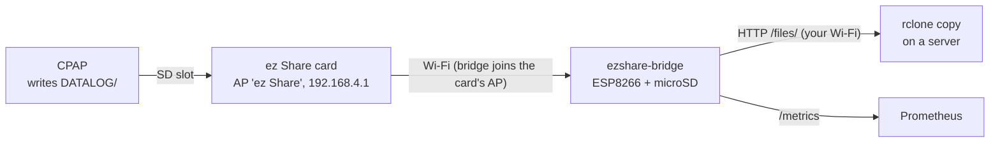

# ezshare-bridge

Firmware that copies a CPAP's data off an [ez Share](https://www.ezsharewifi.com/) Wi-Fi SD
card and makes it available on your home network.

The ez Share card only runs its own access point: it can't join your Wi-Fi. Something has to
join the card's network, download the files, and bring them back. This firmware does that on
a FYSETC SD-WIFI (the non-Pro, ESP8266 model) with a microSD card in its slot:



Every hour inside a daytime window, the bridge:

1. leaves your network and joins the card's;
2. lists the card's root, `SETTINGS/` and recent `DATALOG/` folders, and downloads every file
   that's new or changed to its own microSD;
3. rejoins your network.

Between runs it serves the copied files at `http://<bridge>/files/` for a puller such as
rclone, and health metrics at `/metrics`. The bridge never deletes anything, so your puller
can't lose data because of it.

## Hardware

- **FYSETC SD-WIFI (non-Pro)**: ESP-M2 module (ESP8285, 1 MB flash), microSD socket on SPI
  (CS GPIO4, SCK 14, MISO 12, MOSI 13), CH340E USB serial. Leave its SD-card edge unplugged;
  power it from USB.
- **A microSD card**, FAT32. The bridge keeps a full copy of what it downloads. A night of
  ResMed data is a few MB, so any size works.
- **An ez Share Wi-Fi SD card** in the CPAP.

The ESP8266 has one radio, so it can be on only one network at a time. While a sync runs
(seconds to a few minutes), the bridge is unreachable from your network.

## Set up

You need [mise](https://mise.jdx.dev/), which installs `uv` and runs PlatformIO through it.

### 1. Credentials

Either copy the example and fill it in:

```bash
cp include/secrets.h.example include/secrets.h
```

or write it from 1Password with `mise run secrets`. That needs two items:

- one with fields labelled `wifi_network` and `wifi_password` for your network;
- one with fields labelled `ezshare_ssid`, `ezshare_password` (the card's defaults are
  `ez Share` and `88888888`), `ota_password` and, optionally, `hostname`.

Put their IDs in `mise.local.toml`, which is gitignored:

```toml
[env]
OP_ACCOUNT = "your-account"
EZB_OP_VAULT = "vault-id"
EZB_WIFI_ITEM = "item-id"
EZB_BRIDGE_ITEM = "item-id"
```

### 2. First install

Set the board's switch to `USB2UART`, plug it in, and run:

```bash
mise run flash
mise run monitor   # prints the IP address it gets
```

The bridge sends its hostname (`ezshare-bridge` unless you set `BRIDGE_HOSTNAME`) with every
DHCP request, so you can find it in your router's client list and reserve its address. It
also answers to `<hostname>.local` over mDNS.

### 3. Later installs

```bash
mise run ota <ip-or-hostname.local>
```

## Pulling the files

The `/files/` index is plain HTML links, which rclone's `http` backend reads:

```bash
rclone copy :http: /path/to/cpap-data \
  --http-url http://<bridge>/files/ \
  --transfers 1 --checkers 1
```

The bridge serves one request at a time, hence `--transfers 1 --checkers 1`. Each file has
an exact `Content-Length` and a `Last-Modified` time taken from the card, so rclone only
copies what changed. Don't add `--delete`: if the bridge's microSD is ever replaced, a
mirror with `--delete` would remove your history.

The layout matches the SD card's: `STR.edf`, `Identification.*`, `SETTINGS/`, `DATALOG/<date>/`.

## Metrics

`GET /metrics` returns Prometheus text format:

| Metric | Meaning |
|---|---|
| `ezshare_bridge_sync_last_success_timestamp_seconds` | Unix time of the last run that finished with nothing left to copy |
| `ezshare_bridge_sync_runs_total{result}` | Runs by outcome: `ok`, `join_failed`, `listing_failed`, `download_failed`, `sd_error`, `time_budget` |
| `ezshare_bridge_files_downloaded_total`, `ezshare_bridge_bytes_downloaded_total` | Copied from the card |
| `ezshare_bridge_pending_files` | Files the last run left for the next one |
| `ezshare_bridge_sd_ok`, `ezshare_bridge_sd_free_bytes` | The bridge's microSD |
| `ezshare_bridge_wifi_rssi_dbm{network}` | Signal on your network (`home`) and the card's (`ezshare`, as of the last run) |
| `ezshare_bridge_uptime_seconds`, `ezshare_bridge_free_heap_bytes`, `ezshare_bridge_build_info{version}` | Device health |

Counters reset when the bridge reboots. A useful alert: the last success is more than a day
old. That covers a bridge that's down, a card it can't reach, and a backlog that never clears.

## Logs

The bridge writes one JSON line per event to the serial console and to `/.bridge/log.txt` on
its microSD: boot, each sync run's outcome, and every failure with its details (the listing
line it rejected, the download that came up short, the network it couldn't join).

```json
{"ts":"2026-11-20T14:00:41Z","up":3612,"level":"error","logger":"ezshare-bridge","event":"download_incomplete","path":"/DATALOG/20261119/20261119_221502_BRP.edf","bytes":512000,"content_length":4190420,"listed_kb":4093}
```

`ts` is empty until NTP answers; `up` (seconds since boot) orders lines regardless. `level` is
one of `debug`, `info`, `warn`, `error`, `fatal`.

| Endpoint | Returns |
|---|---|
| `GET /log` | The current log file |
| `GET /log/unshipped` | Lines not yet acknowledged, with an `X-Log-End` header |
| `POST /log/ack?offset=<X-Log-End>` | Marks those lines shipped |

To forward the log somewhere, fetch `/log/unshipped`, store or print the lines, then
acknowledge `X-Log-End`. A shipper that dies before acknowledging gets the same lines again,
so nothing is lost and the worst case is a duplicate:

```bash
curl -fsS -D headers.txt http://<bridge>/log/unshipped   # the lines, on stdout
end=$(tr -d '\r' < headers.txt | awk 'tolower($1) == "x-log-end:" {print $2}')
curl -fsS -X POST "http://<bridge>/log/ack?offset=${end}"
```

The file rotates to `log.1.txt` at 256 KB once every line has been shipped, or at 1 MB
regardless if nothing is acknowledging it.

## Configuration

Everything besides credentials has a default in `include/config.h`. Override any of them in
`include/secrets.h`:

| Setting | Default | |
|---|---|---|
| `BRIDGE_HOSTNAME` | `ezshare-bridge` | DHCP and mDNS name |
| `TZ_STRING` | `EST5EDT,M3.2.0,M11.1.0` | POSIX time zone of the CPAP's clock |
| `NTP_SERVER` | `pool.ntp.org` | |
| `SYNC_INTERVAL_MINUTES` | `60` | |
| `SYNC_WINDOW_START_HOUR`, `SYNC_WINDOW_END_HOUR` | `9`, `18` | Local hours when syncs may run. Keeps the bridge off the card overnight. |
| `LOOKBACK_DAYS` | `7` | `DATALOG` folders this recent are checked every run |
| `SYNC_TIME_BUDGET_SECONDS` | `600` | A run goes home after this long, even with files left |
| `JOIN_TIMEOUT_SECONDS` | `30` | |

## How it decides what to copy

The card lists sizes rounded to KB and gives every file's modification time. When the bridge
saves a file, it sets the copy's modification time to the card's. A file is current when the
copy exists, its time matches, and its size is within the card's KB rounding.

`DATALOG` folders inside `LOOKBACK_DAYS` are listed every run, since the CPAP may still be
writing to them. Older folders are listed only if the bridge has never copied them. That way
the first run copies everything on the card, and later runs stay short as the card fills up.

A download goes to `<name>.part` first and is renamed only after its length checks out, so a
puller never sees a partial file.

If the card returns a listing line the parser doesn't recognise, the run fails with
`listing_failed` rather than skipping the entry, so a format change can't silently drop data.

## Development

```bash
mise run test    # parser and decision tests, on your machine
mise run build
```

`lib/ezshare/` holds the listing parser and download decisions. It has no Arduino code, so the
tests run natively. `src/` is the firmware: `sync.cpp` (network switching, listing, downloads),
`web.cpp` (`/files/` and `/metrics`) and `main.cpp` (setup and scheduling).

## License

MIT
